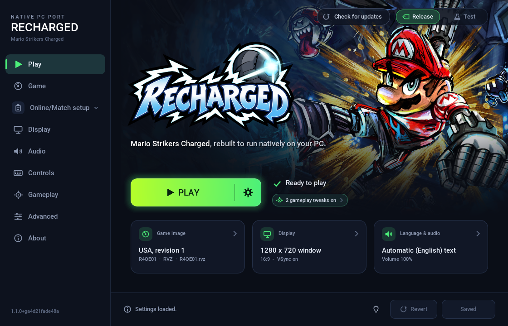

# Recharged — a native PC port of Mario Strikers Charged

Play **Mario Strikers Charged** natively on Windows, Linux, macOS and Steam
Deck. **Recharged** compiles the reconstructed source code of the original
Wii game into a real PC program. It is not an emulator: the game's own code
runs unchanged, and Recharged supplies what the Wii hardware used to provide:
graphics, sound, controllers, disc access and saves.

  

> [!IMPORTANT]
> **The downloads contain no game files.** You need your own copy of
> **Mario Strikers Charged** as an `.iso`, `.rvz` or `.wbfs` disc image: the
> USA version (game ID `R4QE01`, revision 1) or the European version, *Mario
> Strikers Charged Football* (`R4QP01`, revision 1 or 2). Japanese and Korean
> discs are not supported yet.

## Download

Get the package for your system from the
[**latest release**](https://github.com/previouslevelgames/recharged/releases/latest):

<table>
<tr>
<td align="center" width="25%">
 
<code>windows-x86_64.zip</code>
</td>
<td align="center" width="25%">
 
<code>linux-x86_64.tar.gz</code>
</td>
<td align="center" width="25%">
 
<code>steamdeck-x86_64.tar.gz</code> 
<a href="docs/STEAM_DECK.md">Steam Deck guide</a>
</td>
<td align="center" width="25%">
 
<code>macos-universal.dmg</code>
</td>
</tr>
</table>

1. Unpack the package into a folder of its own. On a Mac, open the disk image,
   drag the **Recharged** folder to **Applications** and eject the image.
2. Start `recharged` (`recharged.exe` on Windows). On a Mac, start it the first
   time in Finder from *Applications → Recharged → Recharged.app*, not from
   the disk image; later Spotlight or the Dock start it too.
3. In the launcher, add the folder with your game image (or choose the image)
   and press **Play**.

The Mac app runs natively on Apple Silicon and Intel and is signed and
notarized by Apple: no detour through Privacy & Security. The
**[install guide](docs/INSTALL.md)** covers the first-start prompts of
Windows and macOS. Steam Deck owners should follow the
**[Steam Deck guide](docs/STEAM_DECK.md)**, which also adds the game to the
Steam library. Once installed, the launcher tells you about new versions and
updates Recharged in place when you agree.

## Highlights

- **The whole game.** Domination, the Road to the Striker Cup, Strikers 101,
  the Hall of Fame, cheats, movies, music and sound, with saves like on the Wii.
- **Up to four players** in any mix of keyboard & mouse, gamepads (Xbox,
  PlayStation, Switch Pro, GameCube adapter and more) and **real Wii Remotes**
  with Nunchuk, over Bluetooth or a Mayflash DolphinBar.
- **Sharp picture.** 3D at your window's resolution, 4x antialiasing, 4:3 or
  16:9, any window size or fullscreen.
- **Frame rates.** 30, 60, 120, 144, your display's refresh rate or unlimited,
  while the game keeps its original speed.
- **Optional tweaks**: skip the intro, fast menus, no Mega Strikes, unlock
  everything, CPU vs CPU, fast terrain, Thunder Island walls, mirror matches
  and blue Peach, all off by default. **Fair ball contests**, on by
  default, keeps the home team from winning loose balls more often. Three bugs
  of the original game are fixed.
- **A launcher** that checks your disc, keeps every setting in one place and
  updates itself in place.

See the **[feature list](docs/FEATURES.md)** and the
[default controls](docs/FEATURES.md#default-bindings).

## Your game disc

Recharged needs your own, legally obtained copy of the game as an `.iso`,
`.rvz` or `.wbfs` disc image, which it reads directly from where you keep it. No game
files are included, and this project cannot help you obtain them. The launcher
lists the images in your game folder, checks each one and tells you which
versions it runs; renaming a file does not change its version.

## Roadmap

- **1.0.x: stable and fast.** The whole game on PC, and a launcher that keeps
  everything in one place, made steadier and quicker with every update.
- **1.1.x: online again** (coming soon). The game's own online play, with
  friend codes, invitations and rankings, through our own server and with
  rollback netcode.
- **1.2.x: competitive play** (in development). Challenge a friend or play a
  [start.gg](https://www.start.gg) tournament: you both press Ready and the
  game starts straight into the captain draft, with the same rules for both
  and results that report themselves. You sign in with Discord.
  [More about the plan](docs/COMPETITIVE.md).

Plans can still change if we find better options.

## Questions

**Is this an emulator?** No. The game's original C/C++ code, reconstructed by
the [mscharged-decomp](https://github.com/yannicksuter/mscharged-decomp)
project, is compiled for your PC. Wii hardware is not emulated; Recharged
implements the Wii's system services natively. See
[how it works](docs/ARCHITECTURE.md).

**Does Recharged change the game?** No. Rules, physics, timing and presentation
come from the original code. Changes only happen with the optional tweaks you
turn on, plus the three listed bug fixes.

**Can I play online?** Not in 1.0. Nintendo Wi-Fi Connection has shut down,
so Recharged behaves like a Wii without internet; local multiplayer works.
Version 1.1 brings the game's online play back through our own server; see the
[roadmap](#roadmap).

**Can I mod the game?** The launcher already offers
[optional gameplay tweaks](docs/FEATURES.md#optional-tweaks), and we are
working on a modding framework. Stay tuned.

**What about the Japanese and Korean versions?** The USA and European versions
are supported. For the Japanese and Korean versions we are still working on
the decompilation and on fixing all remaining differences.

**Something does not work.** See [troubleshooting](docs/TROUBLESHOOTING.md).
To report a problem, open an [issue](https://github.com/previouslevelgames/recharged/issues)
and attach `logs/recharged.log` from the program folder.

## Documentation

| Playing | Technical |
| --- | --- |
| [Install guide](docs/INSTALL.md) | [Architecture](docs/ARCHITECTURE.md): how Recharged works |
| [Steam Deck guide](docs/STEAM_DECK.md) | [Building from source](docs/BUILDING.md) |
| [Features and controls](docs/FEATURES.md) | [Dependencies](extern/README.md) |
| [Settings](docs/SETTINGS.md): Wii Remotes, saves, updates, options | [Licenses](LICENSES/README.md) |
| [Troubleshooting](docs/TROUBLESHOOTING.md) | |

## Credits

- [mscharged-decomp](https://github.com/yannicksuter/mscharged-decomp): the
  reconstructed source code of the game, the foundation of Recharged, with
  special thanks to its contributors [Jasu14](https://github.com/Jasu14),
  [vZylev](https://github.com/vZylev) and
  [GoldenPalazzo](https://github.com/GoldenPalazzo).
- [Aurora](https://github.com/encounter/aurora) by Luke Street: the
  GameCube/Wii platform layer, with graphics through
  [Dawn](https://dawn.googlesource.com/dawn).
- [SDL](https://libsdl.org), [Dear ImGui](https://github.com/ocornut/imgui),
  [nod](https://github.com/encounter/nod) (reads the ISO/RVZ/WBFS image) and the
  other [libraries](extern/README.md) Recharged is built with.
- Launcher artwork: the header from the game's key art (Nintendo), the icon
  from SteamGridDB by roryypc.
- Everyone who tested Recharged and sent in logs.

## License

Recharged's original code, tools and documentation use
[CC0 1.0 Universal](LICENSE). Third-party material keeps its own terms; see
[license scope and notices](LICENSES/README.md).

Mario Strikers Charged was developed by Next Level Games and published by
Nintendo. Recharged is an unofficial project, unaffiliated with either company.
No game files are included or distributed.
