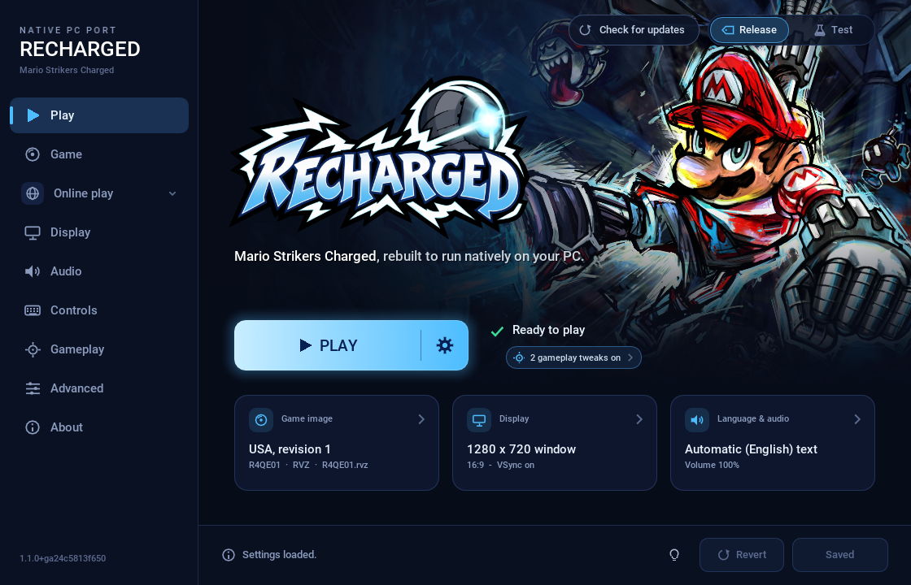

# Recharged — a native PC port of Mario Strikers Charged

Play **Mario Strikers Charged** natively on Windows, Linux, macOS and Steam
Deck. **Recharged** compiles the reconstructed source code of the original
Wii game into a real PC program. It is not an emulator: the game's own code
runs unchanged, and Recharged supplies what the Wii hardware used to provide:
graphics, sound, controllers, disc access and saves.

  

> [!IMPORTANT]
> **The downloads contain no game files.** You need your own, legally obtained
> copy of the game as an `.iso`, `.rvz` or `.wbfs` disc image: USA (`R4QE01`,
> revision 1), Europe (`R4QP01`, revision 1 or 2), Japan (`R4QJ01`) or Korea
> (`R4QK01`). This project cannot help you obtain one.

## Download

Click your system to open the
[**latest release**](https://github.com/previouslevelgames/recharged/releases/latest),
then download the package named below it:

<table>
<tr>
<td align="center" width="25%">
 
Windows 10 / 11, x64 
<code>windows-x86_64.zip</code>
</td>
<td align="center" width="25%">
 
Linux x86_64, Vulkan 
<code>linux-x86_64.tar.gz</code>
</td>
<td align="center" width="25%">
 
SteamOS 3.7+, see the <a href="docs/STEAM_DECK.md">guide</a> 
<code>steamdeck-x86_64.tar.gz</code>
</td>
<td align="center" width="25%">
 
macOS 15+, Apple Silicon and Intel 
<code>macos-universal.dmg</code>
</td>
</tr>
</table>

1. Unpack the package into a folder of its own. On a Mac, open the disk image
   and drag the **Recharged** folder to **Applications**.
2. Start `recharged` (`recharged.exe` on Windows). On a Mac, start it the first
   time from *Applications → Recharged → Recharged.app* in Finder.
3. In the launcher, add the folder with your game image and press **Play**.

The [install guide](docs/INSTALL.md) covers the first start on Windows and
macOS. Once installed, the launcher keeps Recharged up to date in place.

## Highlights

- **The whole game**, every release in its own languages, with saves like on
  the Wii.
- **Online play** through our own
  [server](https://github.com/previouslevelgames/recharged-wfc-srv): friend
  codes, ranked matches and rollback netcode.
- **Up to four players** with keyboard & mouse, gamepads or real Wii Remotes.
- **Sharp and smooth**: your window's resolution, 4x antialiasing, 4:3 or 16:9,
  and high frame rates while the game keeps its original speed.
- **Optional tweaks** such as skipping the intro or unlocking everything, three
  fixed bugs of the original game, and Dolphin texture packs.

See the [feature list](docs/FEATURES.md) and the
[default controls](docs/FEATURES.md#default-bindings).

## Disclaimer: AI assistance

Recharged is built with AI assistance. We want to be clear about how, and where
we stand.

We see AI as a power tool. Like a chainsaw, it is dangerous in careless hands
and a huge multiplier in trained ones. This is a passion project, and AI does
not change that: it lets a small team take on a project of this size and spend
its care where it matters, on bringing Mario Strikers Charged to PC.

What AI cannot change is the game itself. Its code comes from
[mscharged-decomp](https://github.com/yannicksuter/mscharged-decomp),
reconstructed until it compiles to the exact bytes of the retail Wii
executable. Rules, physics and timing are the original's: verified, not
invented.

How we use it:

- **Code.** What Recharged adds around the game (graphics, sound,
  controllers, the launcher and online play) is mostly crafted by hand. AI
  coding agents assist along the way, for example with refactoring, tests and
  repetitive changes. They speed up the work; they don't make the decisions.
  Design and architecture are ours, every change is reviewed, and nothing ships
  until it builds and passes its tests on every platform and has been tried in
  the game.
- **Debugging and analysis.** AI helps us read crash reports and logs faster
  and analyse huge time series in depth, such as our performance and frame-time
  recordings.
- **Documentation.** English is not our first language. Much of the
  documentation is corrected or rewritten with LLMs, from our notes and the code.

**Assets are temporary.** To prototype interfaces, we recycle existing
graphics, and we also allow ourselves to create temporary assets with AI-based
tools. These are placeholders: the prototyping will be followed by a design
process that does not involve AI. Designers who want to be part of that are
very welcome:
[open an issue](https://github.com/previouslevelgames/recharged/issues).

The responsibility stays with us. Every bug in Recharged is ours, not the
tool's. And there will be bugs.

We know AI is a contested topic. If you would rather not use software built
this way, we respect that. If you enjoy playing again, or want to contribute,
you are very welcome.

## Roadmap

**1.2: competitive play** (in development). Challenge a friend or play a
[start.gg](https://www.start.gg) tournament, with the same rules for both and
results that report themselves. [More about the plan](docs/COMPETITIVE.md).
Plans can still change if we find better options.

## Questions

**Is this an emulator?** No. The game's original C/C++ code, reconstructed by
[mscharged-decomp](https://github.com/yannicksuter/mscharged-decomp), is
compiled for your PC; Recharged implements the Wii's system services natively.
See [how it works](docs/ARCHITECTURE.md).

**Does Recharged change the game?** No. Rules, physics, timing and presentation
come from the original code, except for the optional tweaks you turn on and the
three listed bug fixes.

**Something does not work.** See [troubleshooting](docs/TROUBLESHOOTING.md),
and [CONTRIBUTING](CONTRIBUTING.md) for how to report it.

## Documentation

| Playing | Technical |
| --- | --- |
| [Install guide](docs/INSTALL.md) | [Architecture](docs/ARCHITECTURE.md): how Recharged works |
| [Steam Deck guide](docs/STEAM_DECK.md) | [Building from source](docs/BUILDING.md) |
| [Features and controls](docs/FEATURES.md) | [Dependencies](extern/README.md) |
| [Settings](docs/SETTINGS.md): Wii Remotes, saves, updates, options | [Licenses](LICENSES/README.md) |
| [Troubleshooting](docs/TROUBLESHOOTING.md) | [Contributing](CONTRIBUTING.md): reports, ideas, pull requests |

## Credits

- [mscharged-decomp](https://github.com/yannicksuter/mscharged-decomp): the
  reconstructed source code of the game, the foundation of Recharged, with
  special thanks to its contributors [Jasu14](https://github.com/Jasu14),
  [vZylev](https://github.com/vZylev) and
  [GoldenPalazzo](https://github.com/GoldenPalazzo).
- [Aurora](https://github.com/encounter/aurora) by Luke Street: the
  GameCube/Wii platform layer, with graphics through
  [Dawn](https://dawn.googlesource.com/dawn).
- [SDL](https://libsdl.org), [Dear ImGui](https://github.com/ocornut/imgui),
  [nod](https://github.com/encounter/nod) (reads the ISO/RVZ/WBFS image) and the
  other [libraries](extern/README.md) Recharged is built with.
- Launcher artwork: the header from the game's key art (Nintendo), the icon
  from SteamGridDB by roryypc.
- Everyone who tested Recharged and sent in logs.

## License

Recharged's original code, tools and documentation use
[CC0 1.0 Universal](LICENSE). Third-party material keeps its own terms; see
[license scope and notices](LICENSES/README.md).

Mario Strikers Charged was developed by Next Level Games and published by
Nintendo. Recharged is an unofficial project, unaffiliated with either company.
No game files are included or distributed.
