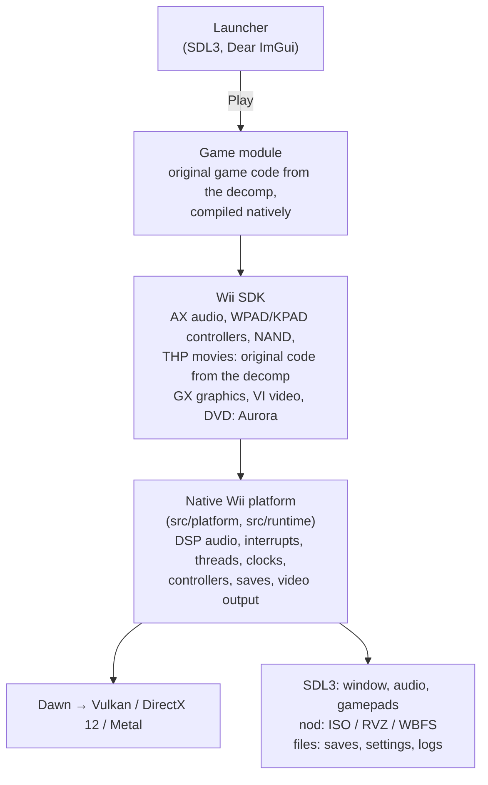

# How Recharged works

Mario Strikers Charged was written in C++ for the Wii. The
[mscharged-decomp](https://github.com/yannicksuter/mscharged-decomp) project
reconstructed that source code: compiled with the original Wii compiler, it
produces the same machine code as the retail game. Recharged compiles the
same source for modern PCs and replaces the Wii hardware underneath it.

It is neither an emulator nor a recompilation of the PowerPC binary. The game
runs as native x86-64 or ARM64 code, and the original code still decides
everything the game does: what to load, how players move, what to draw and
which sound to play. Recharged only supplies the services the Wii provided.

## The big picture



One program, `recharged`, contains the launcher and the platform. Pressing
**Play** closes the launcher and loads the **game module** for the disc's
version (`recharged_game_us` or `_eu`, shared libraries
beside the program) in the same process. The platform sets up the Wii's
memory, clocks and devices, passes the player's settings (controllers, tweaks,
frame rate) to the module, and calls the original `main()`. From there the
game runs exactly its own startup, task loop, menus, matches and shutdown.

## From the decompilation to the program

The game's source is never edited by hand inside Recharged. The build prepares
it in four steps:

1. **Pin.** The decomp, [Aurora](https://github.com/encounter/aurora) and every
   other dependency are Git submodules at exact commits. A new upstream
   version only enters Recharged through a reviewed update of that pin.
2. **Export and patch.** The build exports the decomp's `include/`, `libs/` and
   `src/` trees as committed, then applies the reviewed patch series from
   [`patches/`](../patches/README.md) in order. Each patch is small and states
   why it exists; the submodules stay untouched.
3. **Format.** clang-format lays the prepared copy out for reading. Every
   formatted file is checked token by token against its input, and files whose
   behavior depends on their layout (`__LINE__`, stringified macro arguments)
   are left exactly as patched.
4. **Compile.** The prepared game and SDK code is compiled with GCC or Clang
   into one game module per game version. The decomp builds the USA and the
   European release from the same source, selected by a version macro
   (`VERSION_R4QE01`, `VERSION_R4QP01_REV2`); Recharged compiles the prepared
   tree once for each.

The patches fall into two series:

- **The faithful series** (`patches/mscharged-decomp/`, several hundred
  patches) only adapts the code to a modern compiler and a 64-bit PC: Wii
  compiler syntax and intrinsics, pointer widths, the byte order of the game's
  big-endian data files, and the hand-over to native hardware services. It
  keeps the game's algorithms, timing, bugs and quirks as they are.
- **The tweak series** (`patches/mscharged-decomp-tweaks/`) holds every
  intended change: the optional gameplay tweaks, the frame-rate option,
  four fixes of bugs in the original game, and the adapters that let the
  first European revision's data run on the second revision's code. Each
  change is compiled only into the game module, and the optional tweaks take
  the original path unless turned on.

To see the result without building, prepare the sources alone:

```sh
git submodule update --init extern/mscharged-decomp
python3 tools/prepare_sources.py --build-dir build/release
```

`build/release/prepared/mscharged-decomp/patched/` then holds the pinned
source with the patches applied, and `source/` the formatted copy that is
compiled. Patches are written against `patched/`.

## The Wii, rebuilt natively

| Wii part | How Recharged provides it |
| --- | --- |
| **Graphics** (GX, video interface) | Aurora turns the game's GX commands, textures and TEV shader stages into WebGPU pipelines, which [Dawn](https://dawn.googlesource.com/dawn) runs on Vulkan, DirectX 12 or Metal. Recharged presents the Wii's frame buffer in the window at the chosen size, layout and resolution. |
| **Audio** (AX, DSP, audio interface) | The original AX audio library builds its command lists as on the Wii. Where the Wii's DSP chip ran Nintendo's audio microcode, Recharged processes those commands natively: ADPCM decoding, resampling, mixing and effect sends. The mixed sound goes to SDL audio. |
| **Controllers** (WPAD, KPAD) | The original Wii Remote libraries receive Remote and Nunchuk reports from Recharged: built from keyboard & mouse, from SDL gamepads, or read from real Wii Remotes by Recharged's own HID driver (Bluetooth or DolphinBar), including the camera data for the pointer. |
| **Disc** (DVD) | Aurora's DVD layer reads files straight from the ISO, RVZ or WBFS image through [nod](https://github.com/encounter/nod); nothing is extracted. |
| **Saves** (NAND) | The Wii's flash file system is a folder on disk, so the game reads and writes its own save files. |
| **OS** | Wii threads, alarms, message queues and interrupts run on host threads and timers, at the Wii's own clock rates. The game's MEM1 and MEM2 memory arenas keep their Wii sizes. |
| **Movies** (THP) | The game's own THP player plays the intro, credits and other videos, with the platform providing the timing and audio output. |
| **Network** | The socket library (`src/net`) maps the Wii's sockets onto the host's network stack, and the Wi-Fi configuration reports the host network as a wired connection. The game's Nintendo Wi-Fi Connection names (`*.nintendowifi.net`) resolve to the project's server (`[online] server`), where the game logs in and finds its opponents, as it did on Nintendo's. Network matches run with rollback: a step whose inputs have not arrived runs with predicted ones and is replayed when they arrive and differ (`src/platform/rollback_*.cpp`), with the machines comparing checksums of the game's state. |

## Timing and frame rate

The game keeps its own clock. During a match it simulates at a fixed 50 Hz and
draws each frame from a blend of its last two simulation steps; menus and
cut-scenes advance by the time that passed. The Wii's video signal (59.94 Hz)
keeps running at its real rate, so movies and everything else timed by it stay
exact.

On the Wii a frame waits for the video signal, which caps the game at 60 FPS.
The *Frame rate* option lets Recharged present frames itself instead, at the
display's rate or any cap. Because the game already blends between simulation
steps, the extra frames show real motion; the few things the original code
advances once per drawn frame keep their original pace.

## Graphics pipelines

A GPU needs a compiled pipeline for every combination of shader and render
state the game uses. Compiling one the first time it is drawn would stutter,
so the package carries a catalogue of the configurations recorded from scripted
runs through all stadiums, captains, challenges and lessons
([details](../assets/graphics/README.md)). **Preparing graphics** compiles
them on all processor cores before the game starts and caches the results.
A configuration that is still missing compiles on first use and is logged, so
it can be added to the catalogue.

## Platforms and builds

| Package | Built on | Notes |
| --- | --- | --- |
| Linux x86_64 | Ubuntu 24.04, Clang (GCC 14 C++ runtime) | Vulkan; checked against Ubuntu 24.04 |
| Steam Deck | Ubuntu 24.04, Clang (GCC 14 C++ runtime) | Same build; checked against SteamOS 3.7 |
| Windows x64 | Ubuntu, cross-compiled with LLVM-MinGW | Vulkan or DirectX 12; ships its C++ runtime and the DirectX shader compilers |
| macOS Apple Silicon | macOS 15, Apple Clang | Metal |
| macOS Intel | Cross-compiled on Apple Silicon | Metal |

GitHub Actions builds all five for every pull request into `stable` and every
merge. Pull requests are also published as test builds, which the launcher's
*Test* channel can install ([updates](SETTINGS.md#updates)).

The launcher can update Recharged in place: it checks GitHub for a newer
release, verifies the download against its checksums and the package's file
manifest, swaps only the program's own files and rolls back on any error.

## Repository map

| Path | Contents |
| --- | --- |
| `src/launcher/` | The launcher and its update service |
| `src/platform/` | Native Wii hardware and SDK services: audio, DSP, controllers, Wii Remote driver, file system, OS, video output, logging |
| `src/runtime/` | Game start-up and the hand-over between host and game module, frame pacing, audio output, graphics preparation |
| `src/bootstrap/` | Command line, settings file, shared options |
| `src/resources/` | Native readers for the game's data files: audio banks and streams, images, layouts, cameras |
| `src/net/` | The socket backend |
| `patches/` | The patch series for the decomp and the dependencies |
| `extern/` | Pinned dependencies as submodules ([list](../extern/README.md)) |
| `cmake/`, `CMakePresets.json` | Build configuration and presets |
| `tools/` | Source preparation, packaging, version bumps, pipeline catalogue |
| `tests/` | Unit and integration tests (CTest) |
| `assets/` | Launcher artwork and the graphics pipeline catalogue |
